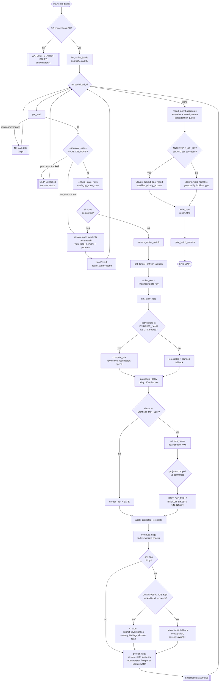

# Watcher - System Overview

End-to-end walkthrough of one wake: from listing active loads in ops, through the
deterministic core, the investigator, and the report agent, to the HTML report. Written
as a reference for explaining any part of the system without having to reopen the code.

---

## 0. Tech stack

| Layer | What | Notes |
|---|---|---|
| Language | Python ≥3.14 | Dataclasses throughout (`data/types.py`) for every data shape passed between stages; no ORM, no web framework |
| Package/env management | [`uv`](https://docs.astral.sh/uv/) | `pyproject.toml` + `uv.lock`; `uv run main.py` runs a wake |
| Ops data source | MySQL, via `pymysql` | Read-only - `load_tender`, `load_stop`, `location_log`, `organization`, `status_event`. Connection built fresh in `main.py::db_connection()` from env vars (`DB_HOST/PORT/USER/PWD/NAME`) |
| Internal persistence | SQLite, via the stdlib `sqlite3` | One file (`internal/db.py`), schema + migrations in `SCHEMA_SQL`/`init_schema()`. The *only* thing the watcher ever writes to - nothing round-trips to ops |
| LLM | Anthropic Claude, via the `anthropic` SDK | Two agents (investigator, report) each force a single structured tool call (`submit_investigation` / `submit_ops_report`) - no free-text output ever reaches the report. Default model `claude-sonnet-4-6`, overridable via `REPORT_MODEL` env var. Requires `ANTHROPIC_API_KEY`; every LLM call point has a deterministic fallback when it's unset or the call fails |
| Config | `python-dotenv` | `.env` loaded once at `main.py` import time |
| Output | Static HTML | `report.py` builds `report.html` via plain Python string concatenation - no templating engine, no client-side framework. A small amount of vanilla JS for the filter chips and journey-diagram flag popups |
| Cost/latency tracking | In-memory, per batch | `llm_metrics.py` - printed at the end of each wake, not persisted |

---

## 1. The shape of the system

Three stages, in strict order, each with a different trust level:

1. **Deterministic core** (`flags.py`, `domino.py`, `eta.py`, `internal/store.py`) - pure
   Python. Computes canonical status, clocks, ETA, the delay cascade, and the five
   incident flags. No LLM involved. This is the only layer allowed to decide *what is
   true*.
2. **Investigator** (`investigator.py`) - Claude, called **only** once at least one flag
   has fired. Reads the deterministic facts and calibrated history, and *interprets*
   them: is this noise or a real problem, how severe, what should ops do. It can never
   change a flag, delete an incident, or alter canonical status - only annotate.
3. **Report agent** (`report_agent.py`, `report.py`) - aggregates every load's result
   into one ranked HTML report. Claude may write the narrative prose; the ranking itself
   is always the deterministic score from `report_agent.py::_severity()`.

Everything writes only to an internal SQLite database (`internal/db.py`). **Nothing is
ever written back to the ops MySQL database** - this is shadow mode by design.

---

## 2. The wake, start to finish

Entry point: `main.py::main()` → `run_batch(now)`.

### 2.1 Startup
- Opens two connections: `db_connection()` (ops MySQL, read-only) and
  `internal_connect()` (the watcher's own SQLite file). If either fails, the batch aborts
  before touching any load (`WATCHER STARTUP FAILED`).
- `reset_batch_metrics()` clears the per-batch LLM cost/latency tracker
  (`llm_metrics.py`).

### 2.2 List active loads
`list_active_loads(conn)` - one SQL query against `main.load_tender`:
```sql
WHERE tender_status IN ('ACCEPTED', 'INTRANSIT')
  AND tractor_number IS NOT NULL
  AND latest_vehicle_assign_time >= UTC_TIMESTAMP() - INTERVAL 1 MONTH
LIMIT 80
```
A load must have a vehicle assigned and be from the last month, capped at 80 per wake.
No ordering - every load is evaluated every wake regardless of urgency (a known
limitation, see the demo deck section 07).

### 2.3 Per load: `run_one_load()`

For each `load_id`, in order:

**a. Fetch the load** - `get_load()`, a joined query pulling `load_tender` +
`organization` (shipper/carrier names) + coordinates. Returns `None` (load skipped) on
a missing row or a mapping failure - never raises out of the loop.

**b. Terminal-status short-circuit.** `is_terminal = canonical_status == "AT_DROPOFF"`.
   - If terminal **and** the watcher has never seen this load before (no `state_rows`, no
     active watch) → `SKIP {id}: untracked terminal status.` Nothing written.
   - If terminal and the watcher *has* seen it → catch up the rows, then
     `_result_if_watch_closed()`: resolves any still-open incidents, closes the watch,
     writes a `load_memory` episode + updates `pattern_store`, prints
     `COMPLETED WATCH for load {id}.`
   - If there's no active watch at all for a non-terminal load that's already fully
     caught up → same close path, printed as
     `SKIP {id}: journey complete, no ACTIVE watch.`

**c. Ledger setup.** `ensure_state_rows()` creates the 5-row skeleton
   (`ASSIGNED → ENROUTE_PICKUP → AT_PICKUP → LOADED → ENROUTE_DROPOFF`) the first time a
   load is seen. `catch_up_state_rows()` marks rows `completed` based on canonical status
   alone - **GPS never advances a row**, only ops status does.
   `ensure_active_watch()` opens (or fetches) the `Watch` header row.

**d. Refresh clocks.** `get_times()` pulls `load_tender` + `load_stop` (pickup/dropoff) +
   `status_event` (for `LOADED`) - the three clocks (planned / committed / actual) per
   milestone. `refresh_actuals()` writes them onto the state rows and seeds
   `forecasted = planned` for any row that's never had a forecast computed.
   The active row is `next(r for r in state_rows if not r.completed)`.

**e. GPS + ETA.** `get_latest_gps()` - most recent `location_log` ping (TELEMATICS,
   MOBILE_APP, FASTAG, or CELLULAR_TRACKING). `compute_eta()` runs **only** when the
   active row is `ENROUTE_PICKUP` or `ENROUTE_DROPOFF` *and* the GPS source is live
   (FASTAG is excluded - it's not a live tracker). ETA math: haversine distance to the
   relevant stop × `ROAD_DISTANCE_FACTOR` (1.3), ÷ live speed (floored at
   `MIN_ETA_SPEED_KPH`, else a flat `DEFAULT_SPEED_KPH`). If GPS or target coordinates
   are missing, ETA stays `None` - never guessed.
   The active row's `forecasted` becomes the ETA value, or falls back to `planned` if
   there's still nothing.

**f. Delay cascade (domino).** `propagate_delay()` (`domino.py`) - runs every wake,
   independent of which flags fired:
   1. `delay = max(0, reference − active_row.planned)` minutes, where `reference` is
      `actual → live ETA → now`, first available.
   2. Below `DOMINO_MIN_SLIP` (30 min) → `SAFE`, nothing projected.
   3. Otherwise, every incomplete row *after* the active one gets `planned + delay`
      (a rigid shift - no per-row slack subtracted yet). If the active row **is**
      `ENROUTE_DROPOFF` itself (nothing left downstream), its own reference time stands
      in for the projected dropoff arrival directly.
   4. Compare the projected `ENROUTE_DROPOFF` arrival to `committed_dropoff_at`:
      `SAFE` / `AT_RISK` (within `DROPOFF_RISK_MARGIN`, 60 min) / `BREACH_LIKELY`
      (beyond it) / `UNKNOWN` (missing data).
   `apply_projected_forecasts()` writes the projected times onto the downstream state
   rows' `forecasted` column (skipping any row that already has an `actual`).

**g. Flags.** `compute_flags()` (`flags.py`) - five deterministic checks, always
   recomputed fresh, never carried over:

   | Flag | Condition |
   |---|---|
   | `TRANSITION_OVERDUE` | `now > planned + OPERATIONAL_GRACE` (30 min) on the active row |
   | `COMMITMENT_RISK` | ENROUTE only - `BREACHED` if `now > committed` with no actual; `AT_RISK` if `forecasted > committed` |
   | `STALE_GPS` | A *live* source with no ping in over `GPS_STALE_AFTER` (1h); FASTAG never counts |
   | `STATUS_GPS_CONFLICT` | Live GPS within 1 km of a stop the claimed status says it shouldn't be at yet (or vice versa) |
   | `DROPOFF_RISK` | `domino.dropoff_risk in {AT_RISK, BREACH_LIKELY}` |

   Also produces the three `Watch` health dimensions: `progress_state`,
   `commitment_state`, `evidence_state`.

**h. Investigator (conditional).** `should_investigate(flags)` - true iff any flag fired.
   If so, `investigate()` builds a JSON context (`build_context()`: load facts, active-row
   clocks, remaining rows, flags, GPS, **open incidents with `wakes_open` counts**,
   calibrated memory, the domino projection) and calls Claude with a forced
   `submit_investigation` tool call. No `ANTHROPIC_API_KEY` or any exception →
   `_fallback()`, a deterministic `Investigation` (severity `WATCH`, one unsuppressed
   finding per flag, no narrative). The investigator can suppress a finding as noise but
   can never make a flag disappear from the incidents table.

**i. Persist.** `persist_flags()`:
   - Copies the three `Watch` health fields from `flags`, updates the watch row.
   - **Resolve loop**: every currently-`OPEN` incident whose correlation key's state no
     longer matches the active row (or whose type stopped firing) gets marked
     `RESOLVED`. (`DROPOFF_RISK` is special-cased to the `ENROUTE_DROPOFF` state
     regardless of the *literal* active row, since it can span the whole tail of the
     journey.)
   - **Open/reopen loop**: every firing incident type gets `upsert_incident()`'d -
     insert if new, or update in place if the correlation key already exists. The
     investigator's `recommended_action` replaces the generic `DEMO_ACTIONS` tag only
     when severity is `ELEVATED`/`CRITICAL`. `times_seen` increments on every wake an
     incident stays open, and resets to `1` on a genuine reopen (see §4).

**j. Assemble `LoadResult`.** The single object that carries this load's entire wake
   outcome - state, flags, incidents (currently open), full incident history, the
   investigation, the domino projection, and the journey rows - forward to the report
   agent.

### 2.4 Batch wrap-up
Each load's `run_one_load()` call is wrapped in its own `try/except` - one load's
exception (`ERROR evaluating {id}`) never aborts the batch. After the loop,
`run_report_agent(results, now)` runs (also exception-guarded), then
`print_batch_metrics()` prints the wake's LLM call count/latency/token totals.

---

## 3. The report agent

`report_agent.py::run_report_agent()` → `aggregate()` → `generate_narrative()` →
`write_html()` (`report.py`).

### 3.1 `aggregate()` - deterministic, always runs
Turns every `LoadResult` into a `LoadSnapshot` (`_snapshot()`), computing:
- **`band`**: `completed` (no active state) / `attention` (`needs_attention()` - true if
  the investigation has any unsuppressed finding or a `WATCH+` severity, or, absent an
  investigation, any flag/incident at all) / `healthy`.
- **`severity`** (`_severity()`) - a numeric score, *not* the LLM: investigator rank
  (`CRITICAL 400 / ELEVATED 300 / WATCH 200 / CLEAR 0`) + commitment `BREACHED +100` /
  `AT_RISK +80` + dropoff risk `+70`/`+60` + conflict `+50` + overdue `+60` + stale GPS
  `+30` + unmapped status `+20` + `+5` per open incident. **This is what sorts the
  attention queue** - the LLM never re-ranks it.
- **`incident_wakes` / `incident_is_new`** - `max(times_seen)` across this load's
  currently-open incidents; "New" iff the longest-standing one has only been open one
  wake.
- **`domino`** - prefers the investigator's own `Domino` object; falls back to one built
  straight from the deterministic `DelayProjection` if the investigator didn't run (or
  didn't reflect on it).

The `attention` list is sorted by `severity`, descending, before anything else happens.

### 3.2 `generate_narrative()`
`_deterministic_narrative()` always runs first as the fallback. If
`ANTHROPIC_API_KEY` is set, `_llm_narrative()` is attempted - Claude receives a slimmed
JSON payload (journey diagram detail stripped out) and must call
`submit_ops_report` with a headline, summary, reasoning, grouped `priority_actions`, and
one-sentence `load_notes`. Any failure of any kind falls back to the deterministic
narrative - the report is never blocked on the LLM.

### 3.3 `write_html()` - pure Python string building, no template engine
Structure of the generated page:
1. **Header** - KPI tiles (evaluated / need attention / new this wake / open incidents /
   completed / healthy).
2. **Attention queue** - one card per load, sorted by `severity`. Each card: severity +
   "New" badge, a deterministic one-line **headline** (`_headline()` - the single
   highest-priority fact, e.g. *"Commitment breached - 17h30m past appointment"*), an
   **action chip** (the recommended action, icon-matched by verb), the four active-row
   clocks, a **delay-cascade block** (a per-milestone "what to expect" table when
   `domino.projected_milestones` exist, else a one-line cause→effect sentence), findings
   collapsed behind **"Show full reasoning"** (bulleted, not prose), and the **journey
   diagram** - six fixed, evenly-spaced milestone markers (see §5), collapsed by default.
   Client-side filter chips (by severity, new/carried-over) let ops triage a large queue
   without scrolling the whole thing.
3. **Completed this wake** / **Healthy watches** - plain tables, no narrative.

---

## 4. Incidents: what "open" actually means

An `Incident` is one durable row keyed by `load_id | state | incident_type` - it's never
deleted, only updated in place (`upsert_incident`). Two things worth being precise about
when explaining this system:

- **`times_seen`** is the one number that's real, ground-truth history: it increments
  every wake the same correlation key is re-confirmed open, and resets to `1` only on a
  genuine reopen (was `RESOLVED`, now firing again). The investigator is given this
  explicitly (`wakes_open` in its context) specifically so it doesn't have to guess a
  wake count from its own past narratives.
- **`status = OPEN/RESOLVED`** is a much weaker signal than it sounds. "Resolved" mostly
  means *the active row moved on and this exact flag condition stopped re-evaluating
  true this wake* - not that the underlying delay was fixed. The journey diagram's
  coloring in `report.py` deliberately does **not** trust this status for its red/green
  decision - it colors a milestone red if *any* incident (open or resolved) was ever
  recorded there, precisely because "resolved" shouldn't read as "solved."

---

## 5. The journey diagram, read correctly

Six fixed, evenly-spaced marker positions - `ASSIGNED, ENROUTE_PICKUP, AT_PICKUP, LOADED,
ENROUTE_DROPOFF, AT_DROPOFF` - regardless of which milestone the load is actually at (no
time-scaling, so no crowding).

The one non-obvious rule: **each `StateRow`'s own clock describes completing the
transition into the *next* state, not reaching its own name** (confirmed directly in
`internal/store.py`'s `_planned_for`/`_committed_for`/`_actual_for` - e.g. the
`ENROUTE_DROPOFF` row's fields resolve straight to `planned_dropoff_at` /
`actual_dropoff_time`, i.e. *arrival at dropoff*, not departure into the dropoff leg). So
each marker displays the **preceding** row's clock: the `AT_PICKUP` marker shows the
`ENROUTE_PICKUP` row's data, `LOADED` shows `AT_PICKUP`'s, and so on. `ASSIGNED` is the
one exception - nothing precedes it, so it shows only its own row's `actual`
(`times.assigned_at`, wired in `_actual_for`), uncolored, since it's a fact with nothing
to compare it against.

The **truck and every flag pin**, by contrast, sit at the marker **literally named**
after the real active state / the state a flag fired on - independent of the label-shift
above. Coloring is binary and flag-driven (§4), not a numeric forecast-vs-planned
comparison - a stale or absent forecast doesn't quietly read as "on track."

---

## 6. Internal database (`internal/db.py`)

| Table | Holds | Written | Read |
|---|---|---|---|
| `watches` | Header - active/completed, 3 health dimensions | First sight, every eval, close on arrival | Every wake; by the report agent |
| `state_rows` | 5 milestone rows - clocks + completion | Skeleton first, refreshed every wake | Every wake |
| `incidents` | One durable row per load·state·type | Upserted while firing, resolved when clear | Every wake; by the report agent |
| `investigator_runs` | Prompt + raw output JSON | Successful investigator calls only | By the investigator, this load's next call |
| `load_memory` | One closed episode - delay, commitment outcome | Watch close only | By the investigator, when triaging |
| `pattern_store` | Rolling delay stats by carrier/lane/shipper | Watch close only | By the investigator, gated at 3 samples |

Nothing here ever round-trips back to ops MySQL.

---

## 7. End-to-end flowchart



---

## 8. Where to look for what

| Question | File |
|---|---|
| "Where does load data come from?" | `main.py` (`get_load`, `get_times`, `get_latest_gps`) |
| "How is a flag computed?" | `flags.py` |
| "How does the delay cascade work?" | `domino.py` |
| "How is ETA calculated?" | `eta.py` |
| "What does the investigator see / decide?" | `investigator.py` |
| "How is severity ranked?" | `report_agent.py::_severity` |
| "How does the HTML get built?" | `report.py` |
| "What's actually in the internal DB?" | `internal/db.py`, `internal/store.py` |
| "How do ops rows map to our dataclasses?" | `data/mappers.py`, `data/types.py` |
| "What are the tunable thresholds?" | `constants.py` |
